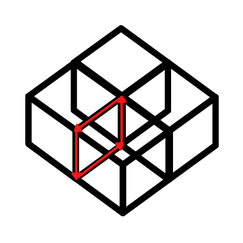
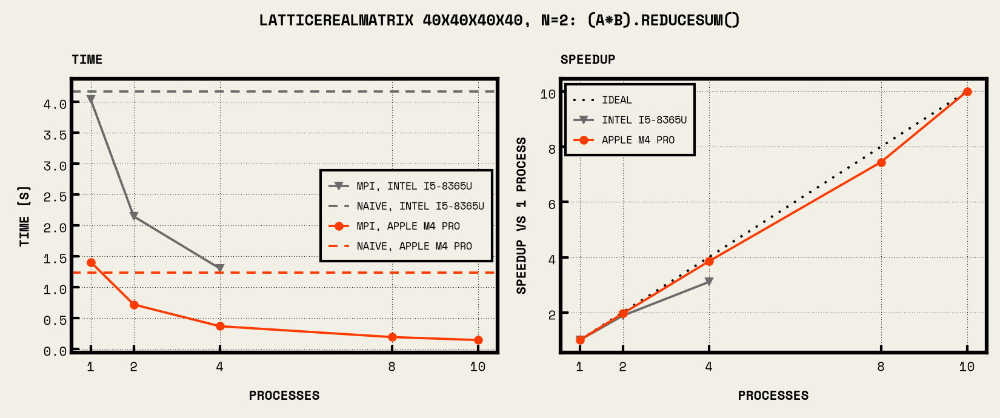

# pyLattice

  

A lattice (gauge) theory simulation library in python.  

## Repository layout

~~~
pylattice/
  core/            tensors, lattice fields on an MPI grid, parallel HDF5 I/O, command line
    groups/        groups and algebras (SU(2) for now)
  theories/
    spin/          variables on sites: Ising
    gauge/         variables on links: SU(2) gauge field
tests/             mirrors the package (tests/core, tests/theories)
benchmarks/        performance evaluation, parallel HDF5 demo
docs/              notes
~~~

Run everything from the repository root, or install the package once with `pip install -e . --no-deps`
(after the environment below), which makes `pylattice` importable from any directory.

# Ising Model 

~~~
mpiexec -np 4 python -m pylattice.theories.spin.ising --grid=20x20 --mpigrid=2x2 --beta=1.5 --steps=2000
~~~

## Performance Test 

~~~
Grid 40x40x40x40

MatrixField = LatticeRealMatrix(lattice=Grid,N=2)
MatrixField2 = LatticeRealMatrix(lattice=Grid,N=2)
(MatrixField*MatrixField2).reducesum()

@ Intel(R) Core(TM) i5-8365U CPU @ 1.60GHz
  (4 cores, 2 threads per core)
@ Apple M4 Pro (10 performance + 4 efficiency cores)
~~~

Strong scaling at fixed global size, best of 3 runs. "Naive" is a plain per-site `np.dot` loop without MPI.

~~~
mpiexec -np 4 python benchmarks/performance_evaluation.py --mpigrid=2x2x1x1
~~~

## macOS installation (Apple Silicon, conda-forge)

Tested on macOS with an Apple Silicon (arm64) Mac. Everything comes from conda-forge, so MPI, HDF5, `mpi4py` and `h5py` are built against each other and no `apt-get` or manual OpenMPI build is needed.

~~~
conda create -n pylattice -c conda-forge --override-channels \
  python=3.11 numpy scipy matplotlib psutil pytest rich openmpi mpi4py "h5py=*=mpi_openmpi*"
conda activate pylattice
pip install "plot_style @ git+https://github.com/pretidav/plot_style.git"   # style of the figures, not on conda
~~~

- `--override-channels` makes conda use only conda-forge and ignore the channels in your conda config. This avoids mixing packages from different channels.
- `plot_style` is not on conda-forge: it is installed from GitHub with `pip`, also by `pip install -r requirements.txt`.
- `pip install -r requirements.txt` alone is not enough: the standard `h5py` wheels from PyPI have no parallel HDF5 (`mpio`) support, and `scipy` and `h5py` are not listed in `requirements.txt`.

Check the installation:

~~~
python -c "import h5py; print(h5py.get_config().mpi)"   # must print True
export PYTHONPATH=.          # run from the repository root (not needed after pip install -e . --no-deps)
pytest tests/core/test_tensors.py
python tests/core/test_grid.py
mpiexec -n 2 python tests/core/test_grid_mpi.py
mpiexec -n 4 python tests/core/test_hdf5io.py
pytest tests/theories/spin/test_ising.py
mpiexec -n 2 python tests/theories/spin/test_ising.py      # same checks on a lattice split over 2 (or 1, 4) ranks
~~~

`test_hdf5io.py` uses a 2x2 process grid, so it needs exactly 4 processes. On a Mac with fewer than 4 physical cores, add `--oversubscribe` to `mpiexec`.

## MPI installation (Linux)

### install OpenMPI 
if c++ compiler is not present: 
~~~
sudo apt-get install g++
~~~

if make is not present: 
~~~
sudo apt install make
~~~
then follow: 
~~~
https://edu.itp.phys.ethz.ch/hs12/programming_techniques/openmpi.pdf
~~~

### install mpi4py - openmpi 
~~~
conda install -c conda-forge mpi4py openmpi
~~~

### note 
mpi takes advantage of physical CPUs only. 
This number can be checked with 
~~~
import psutil 
print(psutil.cpu_count(logical=False))
~~~

## HDF5 installation 

~~~
conda install -c conda-forge "h5py>=2.9=mpi*"
~~~

Run test script 

~~~
mpiexec -n 4 python benchmarks/hdf5_demo.py
~~~

check hdf5 file output structure with 

~~~
h5dump -n parallel_test.hdf5
~~~

and inspect it with 

~~~
h5dump -D /test parallel_test.hdf5
~~~
